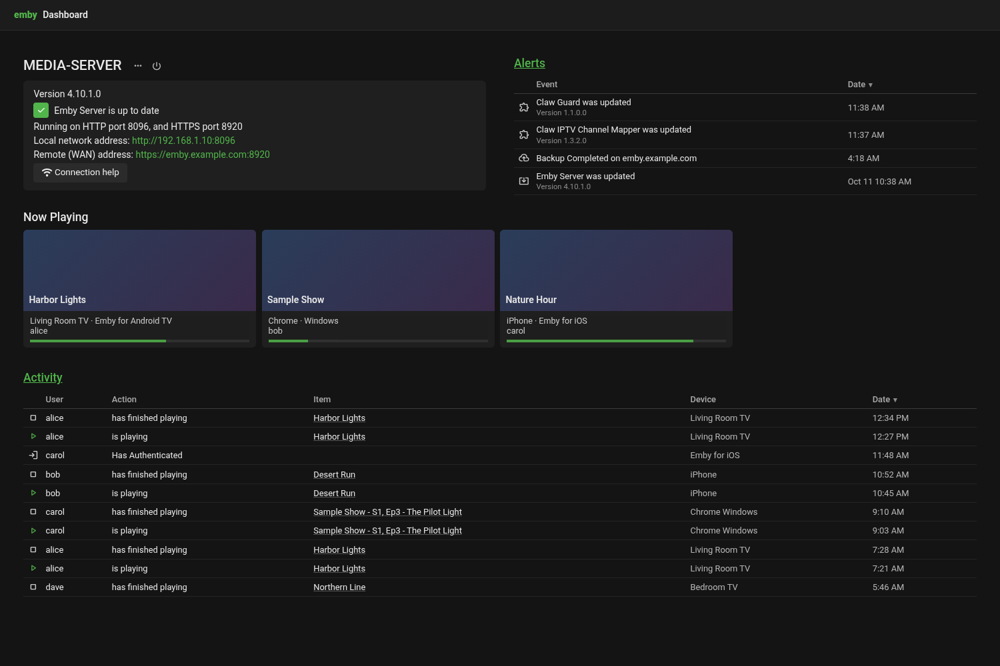
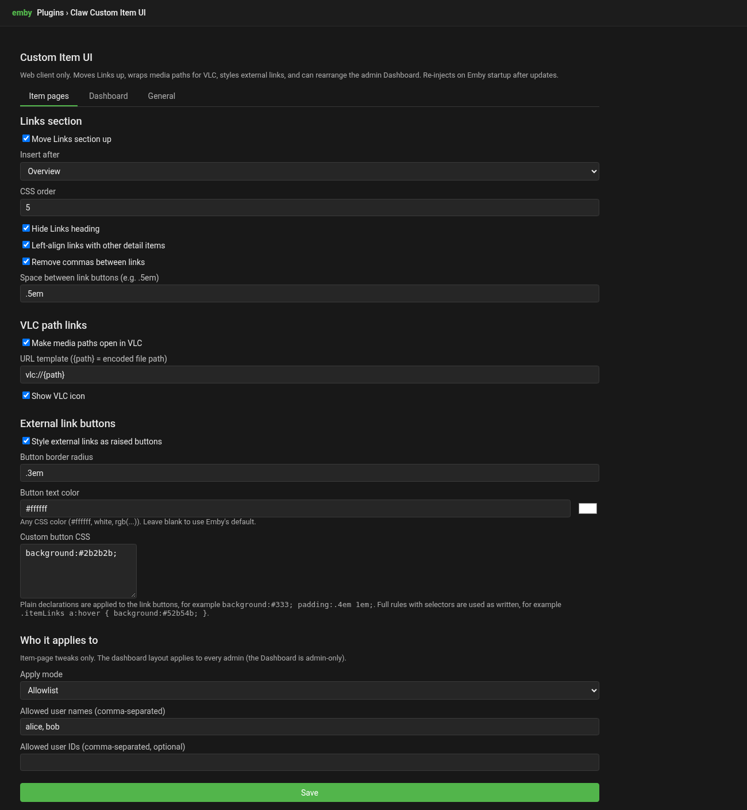

# Claw.Emby.CustomItemUI

Emby Server plugin for item-page web UI tweaks without browser extensions:

- Move the **Links** section up on the item detail page
- Wrap media **file paths** in VLC (cvlc:///...) links
- Style external links as **raised buttons**
- Rearrange the admin **Dashboard** home page into rows (v1.1)

Settings live in the Emby dashboard (**Settings → Custom Item UI**). The plugin re-injects a small JS file into `dashboard-ui` on every Emby startup so core updates do not permanently wipe the behavior.

> Web client only. Emby native apps do not run this script.

## Requirements

- Emby Server 4.10.x (built/tested against 4.10.0.40)
- .NET 8 SDK to compile (dotnet --list-sdks should show an SDK; runtime-only is not enough)

## Build

```powershell
$env:Path=[Environment]::GetEnvironmentVariable('Path','Machine')+';'+[Environment]::GetEnvironmentVariable('Path','User')
cd E:\Apps\Emby-plugins\Claw.Emby.CustomItemUI

# refs\ holds copies of the Emby DLLs (MediaBrowser.Common/Controller/Model).
# Or build against the live server instead:
#   dotnet build -c Release /p:EmbyServerPath=$env:APPDATA\Emby-Server\system
dotnet build -c Release
```

Output: `bin\Release\Claw.Emby.CustomItemUI.dll`

## Install

See `E:\Apps\Emby-plugins\README.md` for the full stop / copy / start sequence. In short:

1. Stop EmbyServer **and** every embytray process, and wait until both are gone.
2. Copy `Claw.Emby.CustomItemUI.dll` into `%APPDATA%\Emby-Server\plugins\`.
3. Start `EmbyServer.exe`.
4. Hard-refresh the browser (Ctrl+F5) and check the browser console for `[claw-emby-ui] loaded (plugin inject)`.

On startup the plugin writes:

- `%APPDATA%\Emby-Server\system\dashboard-ui\claw-custom-item-ui.js`
- a `<script src="claw-custom-item-ui.js" defer></script>` tag into `index.html` (idempotent)

## Settings

| Setting | Purpose |
|--------|---------|
| Enable plugin | Master switch (item page and dashboard) |
| Move Links / insert after / order / hide heading | Links placement |
| VLC path links / URL template / icon | Path → VLC |
| Raised buttons / border radius | External link look |
| Apply mode + allowlists | all / admins / allowlist (item-page tweaks only) |
| Dashboard layout (v1.1) | see below |

URL template default: `cvlc:///file:///{path}` (`{path}` is URI-encoded).

## Dashboard layout (v1.1)

Rearranges the sections of the admin Dashboard home page on a 12-column row grid. The settings page has two editors for the same layout:

- **Row builder**: drag a section by its handle into another row, between sections, or onto a "new row" zone. Each tile has a width (1–12), a Shown/Hidden toggle and ◀ ▶ ▲ ▼ buttons. A row's widths are summed, and the page won't save if a row adds up to more than 12.
- **Table (number boxes)**: Visible / Row / Order / Width for each section.

Default layout:

| Row | Sections |
|-----|----------|
| 1 | Maintenance banner (12, only shown in maintenance mode) |
| 2 | Server info 6 · Alerts 6 |
| 3 | Now playing 8 · Running tasks 4 (the "attention" row) |
| 4 | Active recordings 12 (only while recording) |
| 5 | Activity 12 |

- Sections that Emby hides (no running task, nothing playing, no recording, no alerts) take no space. With **Grow to fill** on, the sections left in that row expand: for example, Now playing is full width while no task runs. Emby still hides Now playing when nothing plays; there is no placeholder.
- Options: stack into one column below N px (960), number of Alerts entries (4), number of Activity entries (10), and Now playing cards per row (Automatic = Emby's default).
- The config is re-read every time the dashboard is shown, so a saved change applies the next time you open the dashboard.
- Safe fallback: if Emby's dashboard markup changes and a required section (Server info, Alerts, Now playing, Activity) can't be found, nothing is touched and a console warning is logged.
- Turning **Enable custom dashboard layout** off (or the master switch) removes everything the plugin added, giving the stock dashboard exactly.
- Applies to every admin who opens the Dashboard. The item-page Apply mode doesn't affect it.

## Changelog

- **1.2.3.0**: The settings page is split into tabs like Guard's: **Item pages** (Links, VLC path links, external link buttons, who it applies to), **Dashboard** (layout editor, Activity/Alerts table options) and **General** (master switch, version, about). The last tab you used is remembered in this browser (localStorage `claw.customitemui.settingsTab`). One **Save** button saves every tab, and the settings themselves haven't changed. If a dashboard row is over 12 columns when you save, the page switches to the Dashboard tab and shows the error.
- **1.2.2.0**: Dashboard Activity and Alerts tables have resizable columns. Drag the right edge of any column header to resize it. Widths are saved per table in this browser (localStorage `claw.customitemui.cols.activity / .alerts`). Double-click an edge to reset the table to automatic widths.

- **1.1.1**: Item page fix. Links (and VLC path links) are now applied on every item page, not only the first one opened after a browser refresh. Each item view is handled separately, a debounced observer on the visible item view re-applies the changes whenever Emby fills in or re-renders the links or media info (new items, metadata refresh, back navigation), and the observer is disconnected when the view is hidden.
- **1.1.0**: Dashboard layout.
- **1.0.0**: Links up, VLC path links, raised link buttons.

## Retiring old PowerShell patches

After this plugin is verified, disable or remove the scheduled task pieces that rewrite `item.html` / `item.js`. Leave branding Custom CSS as you like.

## Plugin id

`b7e4c2a1-9f3d-4e8b-a6c5-1d2e3f4a5b6c`

Do not change once installed (Emby stores config by id).

## Screenshots (fake data)

All images are in [docs/screenshots/custom-item-ui/](../docs/screenshots/custom-item-ui/).

| | |
|---|---|
| <br/>Dashboard Activity/Alerts tables | <br/>Settings (tabs) |
