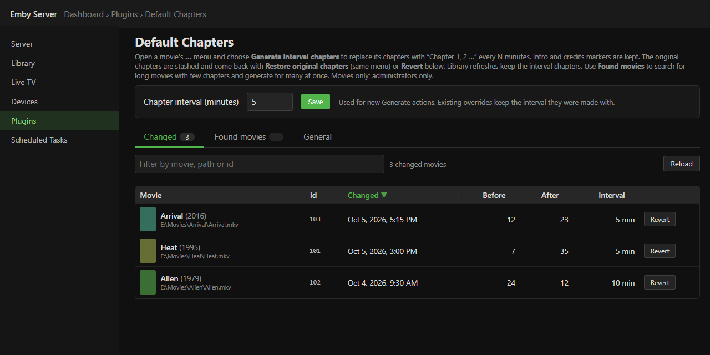

# Claw.Emby.DefaultChapters

Emby Server plugin (built against Emby 4.10.x) that gives single movies **interval chapters**: "Chapter 1, 2, 3 …" every N minutes (default 5),
the same naming Emby uses for its own auto-generated chapters. The movie's original chapters are stashed and can be put back at any time.

- **Item menu (admins only).** A movie's **…** menu gets **Generate interval chapters**. **Restore original chapters** appears only when a stash exists.
- **Confirm.** If the movie already has an override from this plugin, or its chapters already look like an interval set, Emby's confirm dialog asks first (Cancel is the default button).
- **Markers kept.** Intro and credits markers that Emby found (IntroStart / IntroEnd / CreditsStart) stay. The interval chapters are generated around them.
- **Survives refreshes.** When a library scan or refresh re-reads the file's chapters, the plugin swaps in the interval chapters again before Emby saves them.
- **Settings page** (Dashboard › Plugins › Default Chapters). It holds the interval setting and has two tabs:
  - **Changed**: a filterable, sortable table of changed movies (name, id, when, before, after, interval). Each row has a **Revert** button.
  - **Found movies** (v1.1): a manual search for movies *longer than X minutes* (default 60) with *Y or fewer chapters* (default 3). It can optionally hide movies that are already changed (default on). The criteria are saved in the plugin configuration.
    - Results show a checkbox, poster, name, runtime, chapter count (intro/credits markers are shown but not counted) and path. You can filter, sort and page them 100 at a time, with select-all-on-page and select-all-matching.
    - **Generate for selected…** asks once (count + interval + how many will be replaced), then sends batches of 10. Each row also has its own **Generate** button.
    - Generated rows show **Done**, and the movies appear on the Changed tab. Failed rows show the error and stay selectable for a retry.
    - Nothing is scanned at startup or in the background; the library is searched only when you press **Find matches**.
- **Scope.** Movies only: feature `Movie` items in a Movies or mixed library. Episodes, recordings, home videos, trailers and extras are never offered or touched. There is no bulk or automatic scan; every change starts with an admin action.
- **Chapter images.** The plugin asks Emby to attach chapter images without extracting anything. In thumbnail-set mode, every chapter points at the item's existing thumbnail set.

## How it works

| Piece | What it does |
| --- | --- |
| `Core/ChapterGenerator.cs` | Pure chapter math: interval list (0, N, 2N … under the runtime, capped at 99 like Emby), marker clean-up and merge, "looks like an interval set" detection. |
| `Core/OverrideStore.cs` | Plugin-owned JSON store at `<Emby data>\claw-defaultchapters\overrides.json`, keyed by Emby's internal item id. Each record has the name, path, when, before and after counts, interval, and the **original chapter list**. Writes are atomic (temp file, then move) and serialized under a lock. |
| `Core/DefaultChaptersManager.cs` | Generate, Restore and refresh re-apply logic. A second Generate keeps the first stash, so the original is never overwritten by an interval set. |
| `Core/EmbyChapterHost.cs` | The only place that talks to Emby: `ILibraryManager`, `IItemRepository.GetChapters/SaveChapters`, `RefreshThumbnailImages`. |
| `Providers/IntervalChapterProvider.cs` | Refresh hook: an `ICustomMetadataProvider<Movie>` + `IForcedProvider`. Emby runs it after the media-info probe fills `result.Chapters` and before `SaveItem` writes them. For movies in the store it replaces that list. All other items are left alone. |
| `Api/DefaultChaptersService.cs` | Admin-only REST: `GET /DefaultChapters/Overrides`, `GET /DefaultChapters/Items/{Id}/Status`, `POST …/Generate?Confirmed=`, `POST …/Restore`. Generate re-checks on the server and refuses without `Confirmed=true` when a confirm is due. v1.1 adds `GET /DefaultChapters/Found?MinRuntimeMinutes=&MaxChapters=&ExcludeOverridden=` (read-only scan) and `POST /DefaultChapters/GenerateMany?Ids=1,2,3&Confirmed=` (max 200 per call, each id through the same Generate path; one failure does not stop the rest). |
| `InjectEntryPoint.cs` + `Inject/claw-default-chapters.js` | Emby 4.10 has no server API for the item menu, so a small web-client script registers an `itemmanager` command source. The script is written into `dashboard-ui` with a `<script>` tag in `index.html`, about 20 s after startup and checked again at 90 s. |
| `Web/config.html`, `Web/config.js` | Settings page (classic AMD controller, ES5). |

**Restore:** writes the stashed chapters back, together with the current intro/credits markers, and deletes the record (the settings row). If the movie is no longer in the library, the row is simply dropped.
**File replaced:** if a refresh finds chapters in the file that differ from the stash (and are not our own interval set), the stash is updated to the new file's chapters. Restore then goes back to those. The row shows a "file changed" chip.

## Build

Requires the .NET 8 SDK. Emby reference DLLs are in `refs\` (copied from Emby Server 4.10). To build against an installed server instead, run `/p:EmbyServerPath=…\Emby-Server\system`.

```powershell
cd E:\Apps\Emby-plugins\Claw.Emby.DefaultChapters
dotnet build -c Release
# -> bin\Release\Claw.Emby.DefaultChapters.dll  (version 1.2.0.0)
```

## Install (manual)

1. Stop Emby and **all** tray processes, then wait until they are gone:
   ```powershell
   Get-Process EmbyServer, embytray -ErrorAction SilentlyContinue | Stop-Process -Force
   while (Get-Process EmbyServer, embytray -ErrorAction SilentlyContinue) { Start-Sleep -Milliseconds 500 }
   ```
2. Copy the DLL:
   ```powershell
   Copy-Item .\bin\Release\Claw.Emby.DefaultChapters.dll "$env:APPDATA\Emby-Server\plugins\" -Force
   ```
3. Start Emby again: `Start-Process "$env:APPDATA\Emby-Server\system\EmbyServer.exe"`
4. After about 30 s, hard-reload the web app in the browser (**Ctrl+F5**) so it picks up the menu script.

**Uninstall:** stop Emby, delete the DLL, and remove the `claw-default-chapters.js` script tag from `system\dashboard-ui\index.html` (an Emby update resets that file anyway). Then start Emby. Restore any movies you want back first, because the stash lives in `data\claw-defaultchapters\overrides.json`.

## Tests (offline, no Emby server)

```powershell
# C# logic: generator, store, generate/confirm/restore/refresh re-apply, non-movies skipped, index.html patch
cd tests\Claw.Emby.DefaultChapters.Tests; dotnet run -c Release

# Web: item menu + confirm flow, settings table filter/sort/revert (needs Node + puppeteer-core + Chrome)
cd tests\web; npm install puppeteer-core; node test-menu.js; node test-settings.js
#   set CHROME=<path to chrome.exe> on Windows; --shots writes the preview PNGs
```

The C# harness compiles the plugin's `Core\*.cs` directly, with same-shape stubs for Emby's `ChapterInfo` and `MarkerType`. Emby's shipped DLLs are ReadyToRun images for one OS and do not load in a test process on another OS. The plugin build itself compiles the same files against the real Emby types.

## Notes / caveats

- The menu is a web-client inject, so it shows in the Emby web app and the Windows/desktop app that uses it. Native TV and mobile apps will not show the entries, but refreshes still keep the chapters on every client.
- Custom Item UI also rewrites `index.html` at startup. This plugin writes later (20 s and 90 s) and only adds its own tag if it is missing. An Emby update replaces `dashboard-ui`, and the next start puts the tag back.
- Chapter images: with per-chapter image extraction (not thumbnail sets), new positions have no image until Emby's chapter image task extracts them.
- Interval changes apply to new Generate actions. Existing overrides keep their interval until you Generate again.
- Found-movies scan cost: one library query, then a library-type check and a chapter read per movie above the runtime threshold. Large libraries can take a few seconds. At most 5000 rows are returned per scan (the message says when results are cut).
- Bulk Generate attaches existing chapter images only. In per-chapter image mode, the new positions get images when Emby's chapter image task runs.

## Changelog

- **1.2.0.0**: **General** tab with an **Enable plugin** switch and an About section (version, injected script `claw-default-chapters.js`, GitHub link). Switched off: the item-menu entries disappear, Generate (single and bulk) is refused with HTTP 409, and library refreshes no longer re-apply interval chapters; stored overrides stay and Revert still works. A banner on the settings page shows the off state.


- **1.1.1.0**: Changed and Found tables have resizable columns. Drag the right edge of any column header to resize it. Widths are saved per table in this browser (localStorage `claw.defaultchapters.cols.changed / .found`). Double-click an edge to reset the table to automatic widths. Test: `node tests\web\test-colresize.js`.

- **1.1.0.0**: Settings page tabs (**Changed** | **Found movies**), manual Found scan with saved criteria (MinRuntimeMinutes 60, MaxChapters 3, ExcludeOverridden on), bulk and single-row Generate from the results.
- **1.0.0.0**: Item menu Generate/Restore, confirm, refresh hook, stash store, Changed table with Revert.

## Screenshots (fake data)

All images are in [docs/screenshots/default-chapters/](../docs/screenshots/default-chapters/).

| | |
|---|---|
| <br/>Changed movies (with Revert) | <br/>Found movies (bulk Generate) |
| <br/>General tab: Enable switch and About |   |
