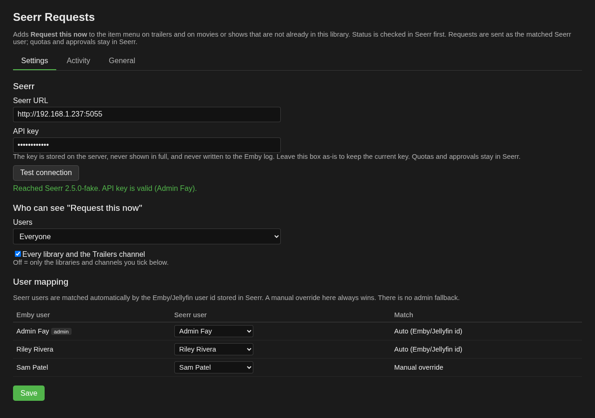
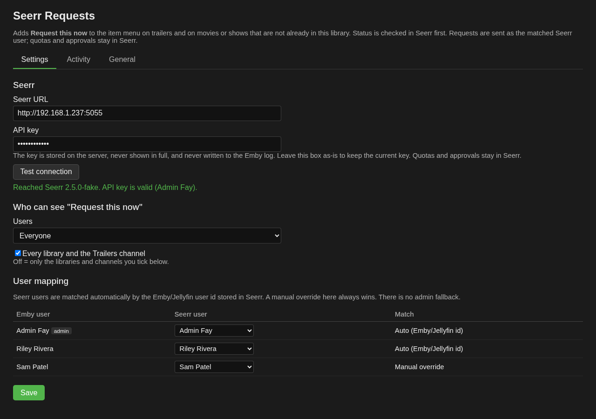
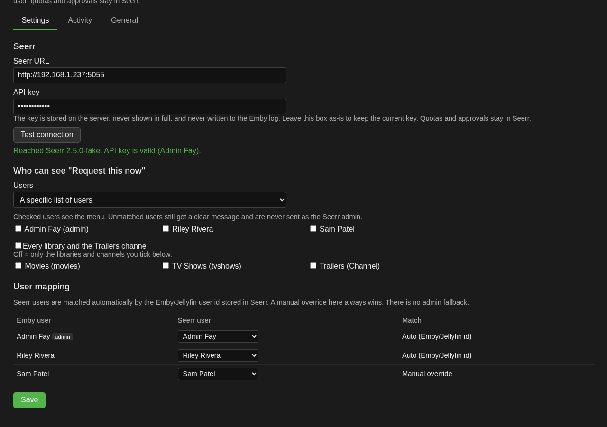
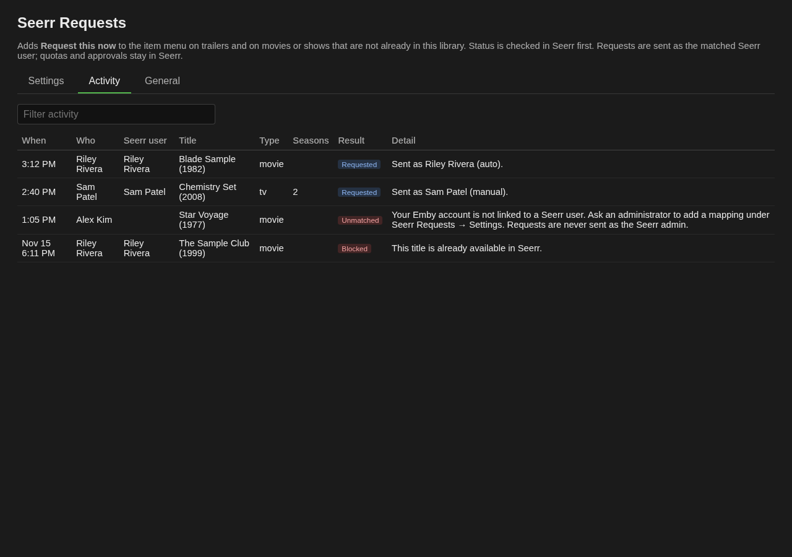
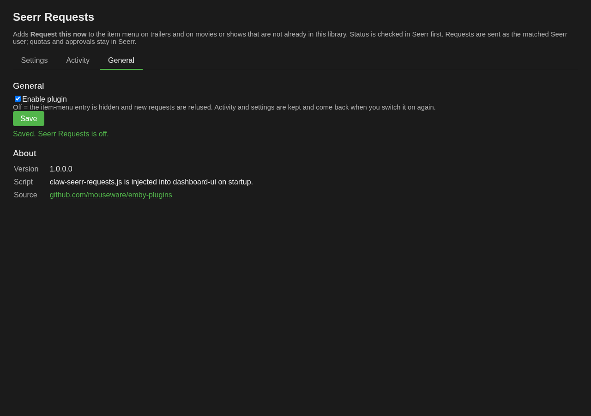
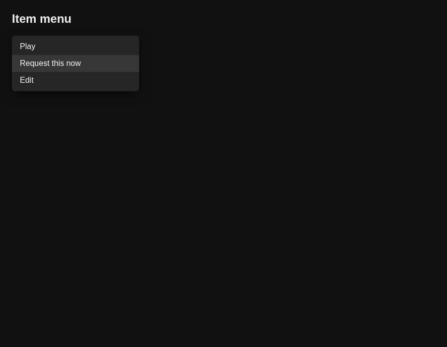
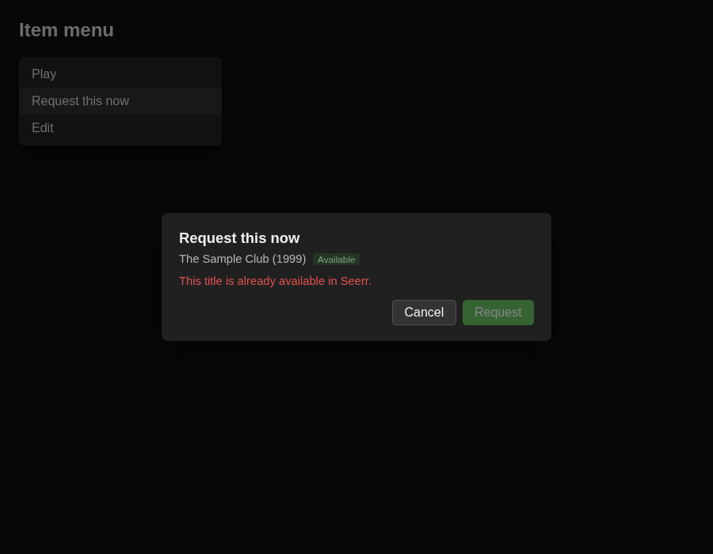
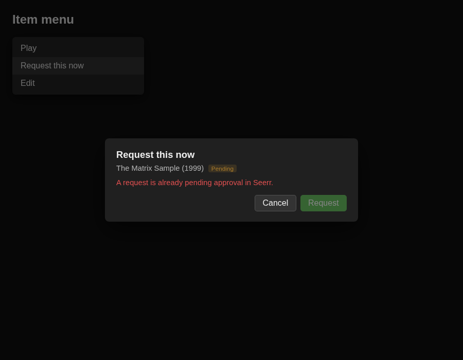
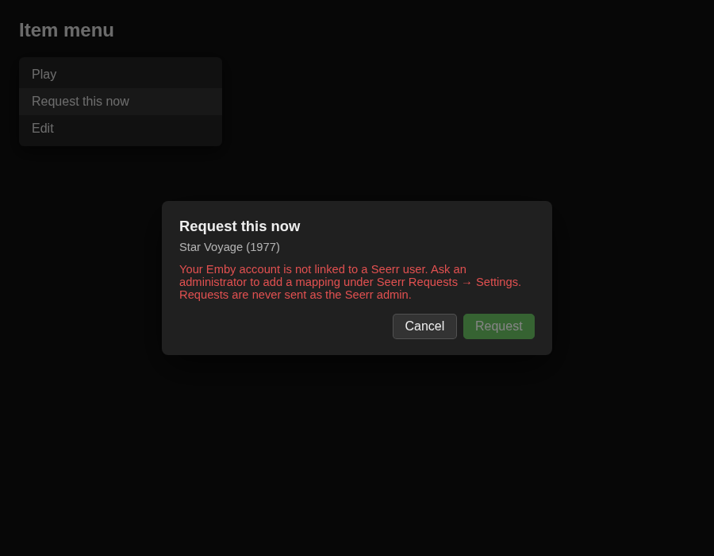
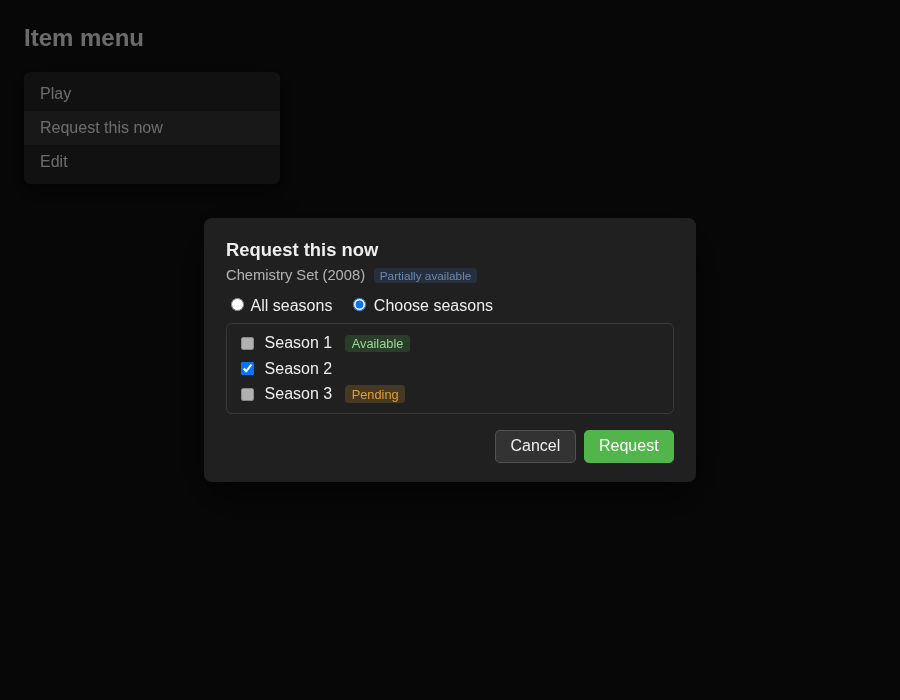

# Seerr Requests (Claw.Emby.SeerrRequests)

Adds **Request this now** to the item "…" menu on trailers and on movies or shows that are not already in the library. Status is checked in Seerr first. Requests are sent as the matched Seerr user; quotas and approvals stay in Seerr.

- **Where it appears:** trailers (including items with ExtraType Trailer / TrailerOf) and Movie / Series / Season items that have no local media (no Path, LocationType Virtual, or MediaSourceCount 0). Owned library movies and shows that already have a file do not show the command. Missing seasons of an already-owned series stay in Seerr for v1.
- **IDs:** the plugin looks the title up in Seerr by TMDb id, then by TVDb or IMDb id, then by title and year.
- **Status first:** the dialog shows Available, Requested, Pending, Declined, Partially available, Blocklisted or None. Available, Pending and Requested movies cannot be requested again. Declined titles may be re-requested. For TV, a season picker is offered (all seasons, or individual seasons that are still missing).
- **Who it is sent as:** every request is made server-side with the Seerr API key plus `X-API-User` of the matched Seerr user. The plugin never puts a `userId` in the request body, and it never falls back to the Seerr admin.
- **Matching:** a manual override in Settings always wins. Otherwise the plugin auto-matches on the Emby/Jellyfin user id stored in Seerr (GUID, dash and case insensitive). Matching an admin account is allowed only when that Emby user really is that Seerr account. Unmatched users see: "Your Emby account is not linked to a Seerr user. Ask an administrator to add a mapping under Seerr Requests → Settings. Requests are never sent as the Seerr admin."
- **Settings:** Seerr URL (default `http://192.168.1.237:5055`; the public address is `https://request.christopherlaw.com`), a masked API key that is never shown in full and never written to the Emby log, **Test connection**, a user-mapping table, and visibility rules (everyone, administrators, or an allowlist of users, plus optional library / Trailers-channel limits).
- **Activity:** a log of who requested what, when, and the result (newest first, last 500). Filterable; columns are resizable.
- **General:** an **Enable plugin** switch and About (version 1.0.0.0, injected script `claw-seerr-requests.js`, GitHub link). Switching the plugin off hides **Request this now** and refuses new requests. Existing settings, mappings and activity are kept.
- **Test connection** calls Seerr's public `GET /api/v1/status` (no key). When a key is saved, it also checks `GET /api/v1/auth/me` as that key, still without logging it.

Dashboard → Plugins → Seerr Requests (or the add_to_queue menu icon). The item-menu entry is added by a small script written into Emby's `dashboard-ui` folder, the same way Default Chapters and Media Integrity do.

## Settings stored on the server

`PluginConfiguration` is saved by Emby as usual. The API key is returned to the dashboard only as a mask (`••••••••` plus the last four characters). A posted mask is ignored, so saving the page does not wipe the stored key. Activity is a JSON file under the plugin's data folder (`claw-seerrrequests`).

## Tests

Unit tests use an in-process mock Seerr (`ISeerrTransport`) and fake users and titles only. From the test project:

```powershell
cd E:\Apps\Emby-plugins\Claw.Emby.SeerrRequests\tests\Claw.Emby.SeerrRequests.Tests
dotnet run -c Release
```

Web tests in `tests/web` (`test-settings.js`, `test-menu.js`) run with Puppeteer and Chrome on the build box. They load the settings page and the item-menu dialog against fake data (Riley Rivera, Sam Patel, Admin Fay, Alex Kim; titles The Sample Club, Blade Sample, Chemistry Set, Star Voyage). They never call a live Seerr except the public status check, which is not part of the test run.

## Screenshots (fake data)

| | |
|---|---|
| <br/>Settings: URL, masked key, Test connection, user mapping | <br/>User mapping (auto and manual) |
| <br/>Visibility: allowlist and libraries | <br/>Activity (who, what, when, result) |
| <br/>General tab: Enable switch and About | <br/>"Request this now" in the item menu |
| <br/>Already available in Seerr | <br/>A request already pending approval |
| <br/>Unmatched user: no admin fallback | <br/>TV season picker |
